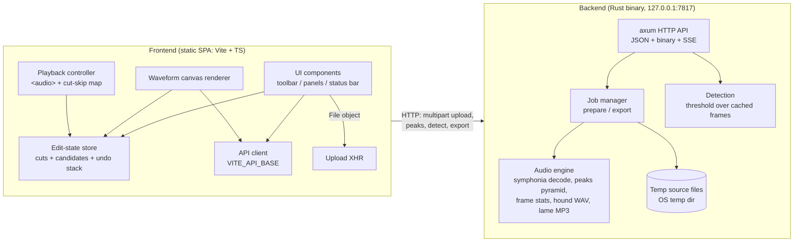
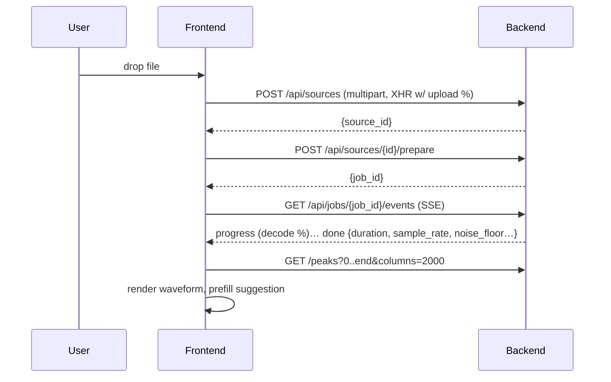

# architecture.md — System Design

_Step 3 of the Idea → Documentation workflow (see `../todo.md`). Status: awaiting review._
_Based on `prd.md` (D1–D22) and decisions taken in Step 3 interviews (D23–D34 below)._

## 1. System overview & context

Two fully deployable parts (D20), joined only by a versioned localhost HTTP API:

- **Frontend** — a static single-page app (Vite + TypeScript, no framework). Owns all interaction state: the edit model (cut list, candidate review status), undo/redo history, waveform rendering, playback control. Runs in Chromium/Firefox; in v1 it is opened via a dev server (`npm run dev`) or any static host and points at the local backend through a configurable API base URL (default `http://127.0.0.1:7817`).
- **Backend** — a single Rust binary (`silence-cutter`). Owns everything heavy and everything file-related: receives uploaded source audio, decodes it, computes waveform peak data and per-frame loudness statistics, runs silence detection, and renders exports (WAV/MP3). Binds to `127.0.0.1` by default; CORS restricted to configured UI origins.

**Modularity contract for the future cloud mode:** the frontend knows the backend only through `docs/architecture.md` §6 (API contract); all edit state lives client-side; the server holds per-source derived data only (temp file + peak/stat caches). Swapping localhost for a remote server later requires: an origin allowlist/CDN change, an upload path suitable for large files, auth (currently none), storage/jobs persistence, and a privacy review (PRD §7). None of those are in v1, but none of them require rewriting the core either.



**Context boundary (what crosses it):** source file bytes (upload), peak arrays (binary), detection requests/results (JSON), export jobs (JSON + SSE + file download). Nothing else — no edit state persists server-side; the user's edits travel only inside the browser (and again as a read-only list on export).

## 2. Tech stack & rationale

| Layer | Choice | Rationale | Rejected alternatives |
|-------|--------|-----------|----------------------|
| Backend language | **Rust** (D13) | Performance for multi-hour decode/analyze/export; memory safety; single static binary potential (post-v1) | Node (GC pauses, weaker audio ecosystem), Python (runtime dep, slower core loops) |
| HTTP framework | **axum + tokio** (D23) | De-facto standard, tower middleware (CORS, limits), first-class SSE/streaming, easy extractors for multipart/binary responses | actix-web (actor model, more moving parts), hand-rolled hyper (reinvents routing), tiny_http (no async/SSE ergonomics) |
| MP3/WAV decode | **symphonia** (pure Rust) | Supports MP3 + WAV (our exact scope, D2), streaming decode without holding full PCM, no system deps | ffmpeg CLI (external process + install requirement), rusty_ffmpeg (binding maintenance) |
| WAV export | **hound** | Tiny, well-maintained writer for PCM WAV | Hand-rolled RIFF writer (trivial but pointless), symphonia write support is not a thing |
| MP3 export | **lame-sys** (libmp3lame bindings) | Battle-tested encoder; GPL-compatible (fits D18 GPL-3.0); we already require a C toolchain (D21) | `shine` (fixed-point, lower quality), ffmpeg CLI (external dep), pure-Rust encoders (immature quality) |
| Analysis parallelism | **rayon** over the frame loop + `spawn_blocking` for jobs | CPU-bound passes parallelize cleanly; keeps tokio reactor free | doing CPU work on async threads (blocks I/O) |
| Frontend build | **Vite + TypeScript, no framework** (D25) | One-page tool; native `<canvas>`/state store is less code than framework plumbing; fewer deps for OSS review | React/Vue/Svelte (bundle + concept overhead for a single view) |
| Waveform | **Custom canvas renderer** fed by backend peaks (D26) | Full control over cut overlays/selection/zoom at 500+ candidates; no impedance with our cut model | wavesurfer.js (DOM regions perf at scale — background R6; its own playback model conflicts with D24) |
| Playback | **`<audio>` element + object URL of the local File, cut-skip controller** (D24) | Zero memory cost for 4 h files, instant reaction to edits, sample-free architecture (NFR-2) | Backend-composed stream (extra jobs per edit), Web Audio buffers (browser PCM → violates NFR-2) |
| Transport | **REST JSON + binary blobs + SSE for job progress** | Debuggable with curl; SSE works through any proxy (cloud-ready), no WebSocket upgrade issues | WebSocket RPC (heavier state), gRPC-Web (codegen friction for an OSS SPA) |
| Tests | **cargo test + vitest + Playwright smoke (committed for v1, P4-T1)** | Matches both ecosystems; e2e locks the import→detect→cut→export loop in CI | e2e-only (misses audio-math bugs), no e2e (regressions in the one flow that matters) |
| Lint/format | **rustfmt + clippy**; **ESLint + Prettier** | Standard, CI-enforceable | custom rules (bikeshed) |

## 3. Components & responsibilities

### 3.1 Backend modules

| Module | Responsibility |
|--------|----------------|
| `api` | axum router; CORS allowlist; request validation; error → JSON mapping (`{code, message, hint}` per FR-21); multipart upload (streamed to temp file, never fully buffered); binary peaks response; SSE job events; export download with `Content-Disposition`. |
| `state` | Registry of **sources**: `source_id → { temp_path, meta }`. Lifecycle: create on upload, delete on `DELETE` (or replaced by UI), **idle sweep** of sources untouched for a TTL (default 60 min — covers tab reloads that never send `DELETE`), startup sweep of `silence-cutter-*` temp files (leftovers from crashes), shutdown cleanup (NFR-4). Frontend additionally fires `navigator.sendBeacon(DELETE)` on `pagehide` as a best-effort cleanup (PRD §10 tab-reload row). |
| `jobs` | Serial per-source job queue (`prepare`, `export`); progress reporting (0–100% + stage); panic isolation (a crashing job yields a job error, not a dead server); cancel-on-drop where feasible (S). |
| `audio::decode` | Streaming symphonia decode over a source file; yields PCM chunks; used by prepare, detect (indirectly — frames are computed at prepare time), and export. |
| `audio::peaks` | Builds the multi-resolution peak pyramid (§4.4) during prepare; serves windowed min/max queries for any zoom. |
| `audio::frames` | During prepare, computes 10 ms frames: `peak_db` (max abs across channels) and `rms_db` — stored as `Vec<f32>` (~4.3 MB each for 4 h) for instant re-detect and noise-floor suggestion. |
| `audio::export` | Assembles the edited timeline from the client's cut list: merge/validate spans, stream kept segments with 5 ms fades at joins, write WAV (hound) or MP3 (lame-sys, 192 kbps CBR; resample to 48 kHz if source rate unsupported by MP3). |
| `analysis` | Threshold + min-duration run-length scan over cached `peak_db` frames → candidate list; noise-floor percentile + 12 dB suggestion (computed once at prepare). Pure function of `(frames, threshold, min_duration)` → trivially unit-testable. |
| `error` | Typed error enum; user-facing message + hint (FR-21); never leak internal paths/stack traces to the client. |

### 3.2 Frontend modules

| Module | Responsibility |
|--------|----------------|
| `api/` | Typed DTOs mirroring §6; `fetch` helpers; SSE subscription helper; `XMLHttpRequest` upload with byte-level progress (fetch lacks upload progress); API base URL from `VITE_API_BASE` (default `http://127.0.0.1:7817`). |
| `state/store` | Single source of truth: `{ sourceMeta, candidates, cuts, selection, playhead, uiFlags }`. Plain subscribe/notify store (≈50 lines); no framework. |
| `state/cutModel` | Pure functions: add cut, toggle cut off, **merge overlapping/adjacent removed spans**, `removedBefore(t)`, `resultDuration()`, `resultToSource(t)`/`sourceToResult(t)` — shared by playback, status bar, export. |
| `state/undo` | Snapshot stack (depth 100) of `{candidates, cuts}` JSON after every mutation (FR-16). Snapshots are tiny (KBs) — snapshots chosen over command pattern for correctness. |
| `audio/playback` | `HTMLAudioElement` control (object URL from the imported `File`); Space/double-click/click-to-seek; **rAF cut-skip loop**: while playing, if `currentTime` enters a removed span, seek to the span's end (~16 ms precision, D24); keeps source-time anchored across edits and derives result-time display. |
| `waveform/` | DPR-aware canvas; requests peaks for the visible window (`start_sample, end_sample, columns = canvas width`) with `AbortController` on pan/zoom; draws waveform, original-time ruler (adaptive tick steps: 1 s…1 h), cut overlays, candidate overlays, selection, playhead. Interaction: drag = select, click = seek, double-click = play, wheel/keys = zoom/pan (FR-03–FR-06, FR-08, FR-13). |
| `ui/` | Toolbar (import, detect, export, undo/redo), detection panel (threshold dB, min duration, "Measure noise floor" showing the backend's suggestion, "Run detection" with confirm dialog per FR-12), candidate inspector (duration, start/end, **Cut this** / **Keep this** buttons), export dialog (WAV/MP3 + result duration), status bar (FR-19 counters), toast errors (FR-21), progress bars (FR-22). |
| `shortcuts` | Keyboard router: Space (play/pause, ignored while typing in inputs), Ctrl/Cmd+Z, Ctrl+Shift+Z, +/- zoom, arrows pan/seek, Delete = cut selection (FR-05, FR-16). |

## 4. Data model

### 4.1 Core concepts

- **Source** — one uploaded file + server-side derived data.
- **Candidate** — a detected silence span (client-side after detection): `{ id, start_ms, end_ms, status: "pending" | "cut" | "kept" }`.
- **Cut** — one removed span in the *source* timeline: `{ id, start_ms, end_ms, origin: "manual" | "detected" }`. For detected candidates the **keep-margin is baked in at acceptance**: `removed = [start + keep/2, end − keep/2]`, clamped (never empty) — manual cuts use `keep = 0` (A5). The export/playback layer only ever sees merged removed spans; "kept" candidates are simply absent from the cut list.

### 4.2 Backend structs (Rust, serde DTOs shown as JSON)

```jsonc
// POST /api/sources → response
{ "source_id": "src_ab12cd" }

// job done payload for prepare
{
  "source_id": "src_ab12cd",
  "filename": "townhall-2026-10.mp3",
  "format": "mp3",
  "duration_ms": 10_812_345,
  "sample_rate": 44100,
  "channels": 2,
  "noise_floor_db": -52.3,
  "suggested_threshold_db": -40.3   // noise floor + 12 dB (A7)
}

// POST /api/sources/{id}/detect → response
{ "candidates": [ { "id": "cand_001", "start_ms": 143_020, "end_ms": 147_560 }, /* … */ ] }

// POST /api/sources/{id}/exports (request)
{
  "format": "wav",                  // or "mp3"
  "filename_hint": "townhall-tightened",
  "cuts": [ { "start_ms": 143_220, "end_ms": 147_360 } ]   // client-merged removed spans
}
```

Server-side in-memory per source: temp file path, prepare results (meta + peak pyramid + frame arrays). All derived caches are reconstructible by re-running prepare (the temp file is the durable input), which keeps the server effectively **stateless regarding user edits** (cloud-ready; §1).

### 4.3 Detection algorithm (normative)

1. Frame size `w = round(sample_rate / 100)` (10 ms, NFR-5).
2. Per frame: `peak_db = 20·log10(max(|x|) over frame and channels)`, guard `-inf → −100 dB`; `rms_db` likewise for suggestion.
3. A frame is silent iff `peak_db < threshold_db`.
4. Maximal runs of silent frames with `run_length ≥ min_duration_ms` → candidate `[start_ms, end_ms)` quantized to frame boundaries.
5. Noise floor = 10th percentile of all `rms_db`; suggestion = `noise_floor + 12 dB` (clamped to [−80, −10]).
6. Defaults: `threshold_db = −40`, `min_duration_ms = 1000`, keep-margin `400 ms` centered (D19).

Runs over cached frames — no re-decode — so "re-run detection" is milliseconds (NFR-1 ≤ 10 s is met with huge margin).

### 4.4 Peak pyramid

Built during prepare in one streaming pass: level 0 = min/max `i16` per 512 samples; each next level aggregates 4× (×4 min/max pairs → 1). For 4 h @ 44.1 kHz: L0 ≈ 1.24 M pairs (4.8 MB); **~6.6 MB total across 5 levels** (fits NFR-2's backend budget; L4 ≈ 4.8 k pairs covers the 4096-column cap). `GET /peaks?start&end&columns` selects the coarsest level ≥ `columns` windows, slices, then min/max-downsamples to exactly `columns` pairs — O(columns) per request regardless of zoom.

### 4.5 Timeline math (normative, shared semantics)

- `merged = sort(cuts) then merge overlapping or ≤1 ms-adjacent spans`.
- `removed_before(t) = Σ length of merged spans fully before t`.
- `result_time(t) = t − removed_before(t)`; `result_duration = duration − Σ lengths`.
- Cut-skip: while playing, if `t ∈ [s, e)` in merged spans → `seek(e)` (audio follows the *edited* timeline, D6).
- Both clocks displayed, original is the ruler of record (D7).

## 5. Key flows

### 5.1 Import (US1, FR-01/02/22)



Temp file streamed to disk (not RAM); prepare streams symphonia decode → pyramid + `peak_db`/`rms_db` arrays; peak fetch after done. UI shows determinate progress the whole time (FR-22).

### 5.2 Detect & review (US3–US5, FR-07–FR-12)

User sets threshold/min-duration (prefilled with suggestion) → confirm **Run detection** → `POST /detect` (sync, fast) → candidates drawn as overlay → user clicks a candidate → inspector shows details + auditions (playhead set just before candidate) → **Cut this** adds baked-margin span to `cutModel` + marks status → **Keep this** marks kept → undo stack snapshot each time. Changing settings does nothing until **Run detection** again, which warns it resets review state (FR-12) — **an undo snapshot is pushed before replacement, so Ctrl+Z restores the pre-re-run candidates and statuses (US7)**.

### 5.3 Playback with cuts (US2/US15, D24/D6)

`<audio>.src = URL.createObjectURL(file)` — the browser plays the original locally; rAF loop checks merged spans and seeks across them; status bar shows `source_time / result_time` and live `result_duration`. Edits take effect immediately because the controller re-reads the store each frame (no player restart).

### 5.4 Export (US8, FR-17/17/18, NFR-5)

Client sends merged cut list → backend job: re-decode source stream → copy kept samples → 5 ms linear fade at each kept-segment edge that borders a removed span → hound/lame write → streamed to a temp output → SSE `done {export_id, filename}` → `GET /download`. Original file untouched (server only ever has its uploaded copy; the user's disk file was never touched). Cancellation via job abort = S.

## 6. API contract (v1)

Base URL: `VITE_API_BASE` (default `http://127.0.0.1:7817`). All responses JSON unless noted. Errors: `{ "code": string, "message": string, "hint": string }` with proper HTTP status (FR-21).

| Method & path | Purpose | Notes |
|---|---|---|
| `GET /api/health` | Liveness + version | Used by UI banner if backend unreachable |
| `POST /api/sources` | Upload source (`multipart/form-data`) | Streamed to temp file; returns `{source_id}`; upload % from client-side XHR |
| `DELETE /api/sources/{id}` | Drop source + derived caches + temp file | Called when starting a new import or leaving |
| `POST /api/sources/{id}/prepare` | Queue prepare job | → `{job_id}`; one job at a time per source |
| `POST /api/sources/{id}/detect` | Run detection (sync) | Body `{threshold_db, min_duration_ms}` → candidates |
| `GET /api/sources/{id}/peaks` | Zoom-window peaks | Query `start_sample, end_sample, columns(≤4096)`; `application/octet-stream`, LE `i16` min/max pairs |
| `POST /api/sources/{id}/exports` | Queue export job | Body §4.2 → `{job_id}` |
| `GET /api/jobs/{job_id}` | Job status (recovery) | `{state: queued|running|done|error|cancelled, result?}` — used after SSE drops, so a tab can learn a job's outcome without re-running it |
| `GET /api/jobs/{job_id}/events` | SSE progress | `event: progress` `{pct, stage}`; `event: done` typed payload; `event: error`. `EventSource` auto-reconnects: on `(re)open` the client must call `GET /api/jobs/{id}` to reconcile terminal state (guards against missed `done`/duplicate events) |
| `GET /api/exports/{export_id}/download` | Fetch finished file | `Content-Disposition`, streamed |
| `DELETE /api/jobs/{job_id}` | Cancel job | S in FR-22; implemented if cheap |

**CORS:** allowlist from `SILENCE_CUTTER_ORIGINS` (defaults: `http://localhost:5173,http://127.0.0.1:5173,http://localhost:4173,http://127.0.0.1:4173` — Vite dev **and** `vite preview`, which serves `dist` on 4173). **Bind:** `SILENCE_CUTTER_ADDR`, default `127.0.0.1:7817` (loopback only; never `0.0.0.0` by default).

Also: the frontend fires `navigator.sendBeacon(DELETE, /api/sources/{id})` on `pagehide` (best-effort session cleanup); the backend's idle TTL (§3.1 `state`) is the safety net.

## 7. Security, privacy, compliance

- **Local trust model (v1):** no auth; loopback binding + CORS allowlist is the boundary. Explicitly documented as insufficient for cloud mode (open question §12).
- **Privacy (NFR-3):** no telemetry/analytics/CDN; audio bytes go only to the configured API; temp files in an OS-private temp dir, unique prefix `silence-cutter-*`, deleted on source delete/shutdown and swept at startup; export files stream to the browser's download location only.
- **Input handling:** the server never accepts filesystem paths from clients — only uploaded bytes (eliminates path traversal); filename from client used only for sanitized `Content-Disposition` (ASCII fallback + RFC 5987 UTF-8); upload size guard (configurable, default 4 GB); JSON body limits.
- **License compliance (NFR-9):** GPL-3.0 for our code; dependency audit in plan (must be GPL-compatible: symphonia MPL-2.0? — **verify MPL-2.0 files-level obligations at plan time**, hound MIT, axum/tokio MIT, lame-sys LGPL — linking from a GPL app is fine).
- **No secrets, no accounts** — nothing to manage.

## 8. Performance, reliability, scalability

- **Budgets (NFR-1/2):** import+prepare 3 h MP3 ≤ 3 min (streaming decode bound; rayon over frame/pyramid pass); detect ≤ 10 s (actually ≪1 s, §4.3); WAV export ≤ 2× duration, MP3 ≤ 3×; backend RAM ≈ 10–20 MB caches + bounded decode buffers ≪ 4 GB; browser holds only the `File`, canvas pixels, and small JSON (≪ 1 GB).
- **UI responsiveness:** all heavy work backend-side jobs; frontend does no PCM work ever; rAF skip-loop cost is O(log n) span lookup (binary search over merged spans).
- **Reliability:** job panics isolated (NFR-4); temp sweep on startup; serial jobs per source avoid contention; typed errors with hints; export validates spans (bounds, ordering, non-empty after merge) before touching audio.
- **Scalability (future cloud):** design keeps sources independent and edits client-side; scale-out would add object storage + a job queue — acknowledged as out of scope (PRD §7).

## 9. Deployment & environments

| Env | How it runs |
|-----|-------------|
| **Dev** | Terminal 1: `cargo run` (backend, `127.0.0.1:7817`). Terminal 2: `npm run dev` (Vite, `localhost:5173`, `/api` requests go to `VITE_API_BASE`). Two documented commands only (D22). |
| **Prod (local use)** | `cargo build --release` + `npm run build`; serve `frontend/dist` from **any** static file server (or `npm run preview`) with `VITE_API_BASE` baked at build time; backend release binary as above. |
| **CI** | GitHub Actions: Rust (fmt, clippy `-D warnings`, tests) + Node (tsc, eslint, vitest) on Linux; caches for cargo/npm. |
| **Cloud (post-v1, not built)** | Same API behind TLS; storage/job/identity layers; privacy review (PRD §7). |

No Docker in v1 (D21 decision covers distribution; containers are orthogonal).

## 10. Testing strategy

| Level | Tool | Scope |
|-------|------|-------|
| Backend unit | `cargo test` | Detection on synthetic signals (known silence positions → exact candidates, edge cases: all-silent, no-silence, 1-sample, dead channel); keep-margin/merge math; noise-floor percentile; peaks pyramid correctness (random buffers vs brute force); WAV/MP3 round-trip on short fixtures |
| Backend integration | `cargo test` (axum test client / reqwest against spawned server) | upload→prepare→detect→export happy path on checked-in tiny fixtures (one WAV, one MP3); SSE event order; error paths (corrupt file, bad spans, unknown ids); temp cleanup |
| Frontend unit | `vitest` | `cutModel` (merge, mapping, result duration), undo stack, playback cut-skip decisions (pure function of time + spans), DTO parsing |
| Frontend e2e (S) | Playwright (Chromium) | Smoke: import fixture → detect → cut one → export, assert download |
| NFR verification (manual task in plan) | scripted checklist | Real 2–4 h file: timings vs NFR-1, memory observation, 10-join click spot-check (success metric §8) |
| CI gate | GitHub Actions | fmt + clippy + tsc + eslint + unit/integration tests green |

Fixtures: generate in-repo (synthesis script) — tiny WAV/MP3 with known silences; never commit large audio.

## 11. Project/folder structure

```
audio_editor/
├── README.md, LICENSE (GPL-3.0), idea.md, todo.md
├── docs/                      # background, prd, architecture, plan, coding-guide, ui-guide
├── backend/
│   ├── Cargo.toml
│   ├── src/
│   │   ├── main.rs            # config, router, bind, startup sweep, shutdown
│   │   ├── api/               # routes.rs, dto.rs, sse.rs, upload.rs, errors.rs, cors.rs
│   │   ├── state.rs           # source registry, temp lifecycle
│   │   ├── jobs.rs            # queue, progress, panic isolation
│   │   ├── audio/             # decode.rs, peaks.rs, frames.rs, export.rs (wav.rs, mp3.rs)
│   │   ├── analysis.rs        # detect + noise floor (pure functions)
│   │   └── error.rs
│   └── tests/                 # integration + fixtures/
├── frontend/
│   ├── package.json, vite.config.ts, tsconfig.json, .eslintrc / prettier
│   ├── index.html
│   └── src/
│       ├── main.ts            # boot, mount
│       ├── api/               # client.ts, sse.ts, types.ts
│       ├── state/             # store.ts, cutModel.ts, undo.ts
│       ├── audio/             # playback.ts
│       ├── waveform/          # renderer.ts, peaksCache.ts, interaction.ts, ruler.ts
│       ├── ui/                # toolbar.ts, detectPanel.ts, inspector.ts, exportDialog.ts, statusBar.ts, toasts.ts
│       ├── shortcuts.ts
│       └── styles.css
├── scripts/                   # fixture generation (dev-only)
└── .github/workflows/ci.yml
```

## 12. Traceability (PRD → components)

| PRD req | Fulfilling component(s) |
|---|---|
| FR-01 import | `api/upload`, `state`, UI import (`waveform` init), `ui/toasts` |
| FR-02 waveform | `audio/peaks` + `GET /peaks` + `waveform/renderer`, `peaksCache` |
| FR-03 zoom/pan | `waveform/interaction`, `ruler` |
| FR-04 ruler | `waveform/ruler` |
| FR-05 click/Space/double-click | `audio/playback`, `shortcuts` |
| FR-06 both clocks | `audio/playback` + `state/cutModel` + `ui/statusBar` |
| FR-07 detection algo | `analysis` + `POST /detect` (spec §4.3) |
| FR-08 candidate overlay | `waveform/renderer` + `ui/inspector` |
| FR-09 accept w/ keep-margin | `ui/inspector` + `state/cutModel` (A5) |
| FR-10 reject | `state/store` + renderer styling |
| FR-11 threshold + noise-floor suggestion | `analysis` (prepare payload) + `ui/detectPanel` |
| FR-12 manual re-run + confirm | `ui/detectPanel` (dialog) |
| FR-13 manual selection/cut | `waveform/interaction` + `state/cutModel` |
| FR-14 cut list non-destructive | `state/cutModel` + `state/undo` |
| FR-15 edited-timeline playback | `audio/playback` (rAF skip, D24) |
| FR-16 undo/redo | `state/undo` + `shortcuts` + toolbar buttons |
| FR-17 export WAV/MP3 | `audio/export` + export job flow + `ui/exportDialog` |
| FR-18 keep-margin in export | `audio/export` (uses client-merged spans already baked) |
| FR-19 status counters | `state/cutModel` + `ui/statusBar` |
| FR-20 lifecycle/CORS/ports | `main.rs`, `api/cors`, README |
| FR-21 error states | `error.rs` + `api/errors` + `ui/toasts` |
| FR-22 progress | `jobs` + SSE + all progress UI |
| FR-23 README/LICENSE | repo root (Step 7) |
| NFR-1/2 perf & memory | §8 budgets; streaming design |
| NFR-3 privacy | §7 |
| NFR-4 reliability | `jobs` isolation, temp sweep |
| NFR-5 accuracy | §4.3/§4.5 + tests |
| NFR-6 browsers | CSS/JS baseline for Chromium+Firefox; CI e2e Chromium |
| NFR-7 accessibility | `ui/` semantics + keyboard router (audited in Step 6 guide) |
| NFR-9 licensing | §7 dependency audit task |

## 13. Decision log (architecture additions)

| # | Decision | Choice | Why |
|---|----------|--------|-----|
| D23 | HTTP stack | axum + tokio + tower (CORS, body limits) | mainstream, SSE/streaming-first, easy multipart |
| D24 | Edited playback | Browser plays local File via `<audio>`; rAF cut-skip over merged spans | zero browser PCM (NFR-2), instant edits, no backend jobs per edit |
| D25 | Frontend stack | Vite + TS, no framework (D from Step 3) | small surface, few deps |
| D26 | Waveform | Custom canvas + backend peaks pyramid | candidate/selection perf; no wavesurfer impedance |
| D27 | Edit-state ownership | **All edits client-side**; export sends merged spans | stateless server → cloud-ready boundary; trivial undo |
| D28 | Detection data | Per-frame `peak_db`/`rms_db` cached at prepare; detect = in-memory scan | re-run in ms; noise floor once per file |
| D29 | Export transport | Job + SSE progress + download endpoint | determinate progress (FR-22) over chunked-response guesswork |
| D30 | Peaks format | i16 min/max LE pairs, ≤4096 columns, 4× pyramid | binary = small payloads; O(columns) queries |
| D31 | Keep-margin placement | Centered on the candidate span, baked into the cut at accept | simple downstream math; A5 |
| D32 | Session model | Multiple sources allowed server-side; UI enforces one active; startup temp sweep | avoids 409 races; cleanup robustness |
| D33 | MP3 export detail | 192 kbps CBR (A1); resample to 48 kHz only if source rate unsupported by MP3 | predictable size/quality; honest edge-case rule |
| D34 | Ports/CORS | `127.0.0.1:7817` default, `SILENCE_CUTTER_*` env overrides, Vite origins allowlisted | loopback safety; no dev/prod friction |

## 14. Open questions (deferred, non-blocking for implementation)

1. **Cloud mode auth** — out of scope (PRD §7); revisit before any hosted deployment.
2. **Job cancellation wire protocol** — `DELETE /api/jobs/{id}` details (S in FR-22); decide during task P3-T… if cheap.
3. **MP3 encoder license notice** — confirm libmp3lame patent posture text for README at release time (no action for v1 local use).
4. **24-bit / high-res edge handling** — WAV export preserves source bit depth (A2); verify symphonia→lame path for 96 kHz sources (resample rule D33 covers MP3).

---
_End of Step 3. Please review `docs/architecture.md` (and the PRD updates: G6, FR-20, NFR-3, decisions D20–D22) — and approve, or request changes, before Step 4 (`plan.md`)._
